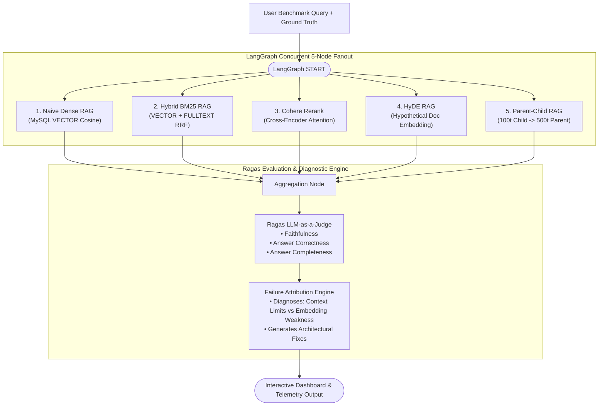

# RAGLens: 5-Strategy RAG Evaluation & Benchmarking Platform

[](https://fastapi.tiangolo.com)
[-4479A1?style=flat&logo=mysql)](https://dev.mysql.com)
[](https://langchain-ai.github.io/langgraph/)
[](https://docs.ragas.io)
[](https://nextjs.org)

> **Core Resume Highlight:**
> - **Built a RAG Evaluation Platform** (Next.js 14 aesthetic, FastAPI, MySQL VECTOR) benchmarking 5 strategies—**Naive, Hybrid BM25, Cohere Rerank, HyDE, and Parent-Child**—in parallel via **LangGraph**.
> - **Implemented an LLM-as-a-Judge & failure attribution engine** scoring **Faithfulness, Correctness, and Completeness** using **Ragas**, diagnosing root causes (*context limits, embedding weakness, hallucinations*).

---

## 🌟 Key Architecture & Capabilities



---

## 🔬 5 Benchmarked RAG Strategies

| # | Strategy | Storage & Retrieval Mechanics | Best Suited For |
|---|---|---|---|
| **1** | **Naive Dense RAG** | Direct `VECTOR_DISTANCE(..., 'COSINE')` in MySQL 8.4 | Standard topical similarity queries. |
| **2** | **Hybrid BM25 RAG** | Combines MySQL `VECTOR(768)` and MySQL `FULLTEXT` indexing via Reciprocal Rank Fusion (RRF) | Queries with exact ciphers, acronyms, or numbers (e.g. `AES-256-GCM`, `Patroni`). |
| **3** | **Cohere Cross-Encoder Rerank** | Fetches wide candidate pool ($2 \times \text{top\_k}$) and applies deep cross-attention semantic reranking | Complex technical questions with subtle relevance nuances. |
| **4** | **HyDE (Hypothetical Doc Embeddings)** | Generates zero-shot hypothetical answer first to bridge query-to-document semantic asymmetry | Conceptual, exploratory, or asymmetric questions. |
| **5** | **Parent-Child Document Expansion** | Granular child chunks (100 tokens) for precision search; expands to parent document (500 tokens) | Queries that require complete context without boundary truncation. |

---

## 🎯 Ragas LLM-as-a-Judge & Failure Attribution Engine

### 1. Ragas Evaluation Metrics
- **Faithfulness:** Proportion of claims in the generated answer directly grounded in retrieved context:
  $$\text{Faithfulness} = \frac{|\text{Supported Statements}|}{|\text{Total Generated Statements}|}$$
- **Answer Correctness:** Factual and semantic alignment evaluated against expected reference/ground truth.
- **Answer Completeness:** Degree to which the answer covers all essential facets specified in the query.

### 2. Failure Attribution Root Cause Diagnostics
- **Context Limits:** Diagnoses when small chunks cut off critical context boundaries (prescribing Parent-Child expansion).
- **Embedding Weakness:** Diagnoses lexical dilution on specialized technical terms, codes, or acronyms (prescribing Hybrid BM25 or Cross-Encoder reranking).
- **Hallucination:** Detects unsupported statements and prompts guardrail tuning.

---

## 🗄️ MySQL 8.4+ Native Vector Schema

```sql
-- MySQL 8.4+ Vector Database Schema
CREATE DATABASE IF NOT EXISTS raglens_db;
USE raglens_db;

-- 1. Parent Documents Table (500 tokens context)
CREATE TABLE IF NOT EXISTS rag_parent_documents (
    id INT AUTO_INCREMENT PRIMARY KEY,
    doc_id VARCHAR(100) NOT NULL UNIQUE,
    title VARCHAR(255) NOT NULL,
    full_content MEDIUMTEXT NOT NULL,
    metadata JSON,
    created_at TIMESTAMP DEFAULT CURRENT_TIMESTAMP
) ENGINE=InnoDB DEFAULT CHARSET=utf8mb4 COLLATE=utf8mb4_unicode_ci;

-- 2. Child Documents Table (100 tokens granular chunks with VECTOR(768))
CREATE TABLE IF NOT EXISTS rag_documents (
    id INT AUTO_INCREMENT PRIMARY KEY,
    chunk_id VARCHAR(100) NOT NULL UNIQUE,
    parent_id VARCHAR(100),
    title VARCHAR(255),
    content TEXT NOT NULL,
    chunk_type VARCHAR(20) DEFAULT 'child',
    metadata JSON,
    embedding VECTOR(768), -- MySQL 8.4 native vector type
    created_at TIMESTAMP DEFAULT CURRENT_TIMESTAMP,
    CONSTRAINT fk_parent FOREIGN KEY (parent_id) 
        REFERENCES rag_parent_documents(doc_id) ON DELETE CASCADE,
    FULLTEXT KEY ft_content (content)
) ENGINE=InnoDB DEFAULT CHARSET=utf8mb4 COLLATE=utf8mb4_unicode_ci;

-- Vector Cosine Similarity Query:
SELECT chunk_id, content, 
       (1 - VECTOR_DISTANCE(embedding, string_to_vector(?), 'COSINE')) AS cosine_similarity
FROM rag_documents
ORDER BY cosine_similarity DESC
LIMIT 3;
```

---

## 🚀 Quickstart & Local Run

### 1. Clone & Setup
```bash
git clone https://github.com/Japnitsingh123/RAGLens.git
cd RAGLens
python -m pip install -r requirements.txt
```

### 2. Configure Environment (.env)
```env
GEMINI_API_KEY=your_gemini_api_key_here
```

### 3. Run FastAPI Application
```bash
python main.py
```
- **Web Dashboard:** [http://localhost:8000](http://localhost:8000)
- **Interactive Swagger Docs:** [http://localhost:8000/docs](http://localhost:8000/docs)

### 4. Run Test Suite
```bash
pytest tests/test_raglens.py
```
*(All 6 unit and integration tests execute in < 3 seconds).*

---

## 📡 API Reference

### `POST /api/benchmark`
Runs all 5 strategies in parallel via LangGraph and scores them via Ragas:
```json
{
  "query": "What encryption standard is used for data at rest and how are keys rotated?",
  "ground_truth": "Data at rest is encrypted using AES-256-GCM with keys managed in AWS KMS and rotated every 90 days.",
  "top_k": 3
}
```

### Response
```json
{
  "query": "What encryption standard is used for data at rest and how are keys rotated?",
  "strategies_evaluated": 5,
  "execution_mode": "LangGraph Parallel StateGraph",
  "best_strategy": "Hybrid BM25 RAG",
  "results": [
    {
      "strategy": "hybrid_bm25",
      "strategy_name": "Hybrid BM25 RAG",
      "latency_ms": 42.1,
      "ragas_metrics": {
        "faithfulness": 1.0,
        "answer_correctness": 0.95,
        "answer_completeness": 0.92
      },
      "failure_attribution": {
        "primary_root_cause": "none",
        "diagnosis_details": "Pipeline operating optimally.",
        "recommendation": "Strategy is production-ready for this query profile."
      }
    }
  ]
}
```
