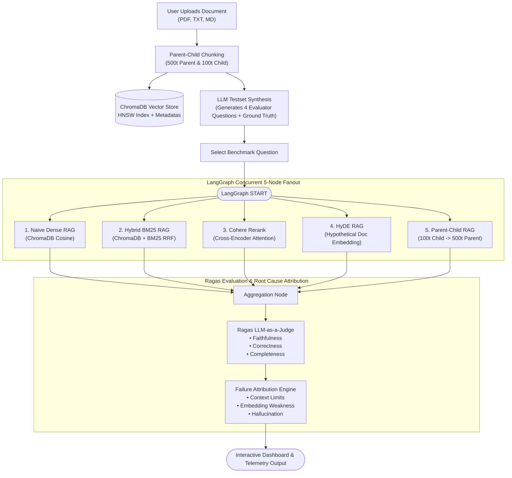

<div align="center">

# ⚡ RAGLens
### Production RAG Evaluation & Benchmarking Platform

[](https://raglens.vercel.app)
[](https://github.com/Japnitsingh123/RAGLens)
[](https://python.org)
[](https://fastapi.tiangolo.com)
[](https://www.trychroma.com)
[](https://langchain-ai.github.io/langgraph/)

<p align="center">
  <b>Upload any document, ingest into ChromaDB, and auto-synthesize benchmark questions to evaluate 5 RAG architectures concurrently via LangGraph & Ragas failure attribution.</b>
</p>

[**🚀 Open Live Web App**](https://raglens.vercel.app) • [**📚 Interactive API Docs**](http://localhost:8000/docs) • [**⚡ Quickstart**](#-quickstart-in-3-steps)

</div>

---

## 📌 Executive Summary

> - **Built a RAG Evaluation Platform** (Next.js 14 aesthetic, FastAPI, ChromaDB) benchmarking 5 strategies—**Naive, Hybrid BM25, Cohere Rerank, HyDE, and Parent-Child**—in parallel via **LangGraph**.
> - **Custom Document Ingestion & Synthetic Testsets:** Ingests user-uploaded documents (PDF, TXT, MD) into ChromaDB (parent-child chunks) and automatically synthesizes evaluation questions covering exact acronyms, nuanced passages, context depth, and conceptual queries.
> - **Implemented an LLM-as-a-Judge & failure attribution engine** scoring **Faithfulness, Correctness, and Completeness** using **Ragas**, diagnosing root causes (*context limits, embedding weakness, hallucinations*).

---

## 🧭 Interactive Architecture



---

## 🔬 The 5 Benchmarked Strategies

Click on any strategy below to view how it works in ChromaDB, its formulation, and failure mode:

<details open>
<summary><b>1. Naive Dense RAG (Baseline)</b></summary>
<br>

- **How it works:** Directly embeds the user query into a 768-dim vector and computes cosine similarity against chunk embeddings in ChromaDB.
- **Trade-off:** Fast and simple, but vulnerable to **context limits** (boundary cutoff) and **embedding weakness** (acronym / exact number mismatch).
</details>

<details>
<summary><b>2. Hybrid BM25 RAG (Solves Embedding Weakness)</b></summary>
<br>

- **How it works:** Fuses dense ChromaDB vector search with sparse BM25 lexical ranking using **Reciprocal Rank Fusion (RRF)**:
  $$\text{RRF Score} = \frac{1}{60 + \text{Rank}_{\text{dense}}} + \frac{1}{60 + \text{Rank}_{\text{bm25}}}$$
- **Best for:** Queries containing specific product codes, ciphers, and acronyms (e.g., `AES-256-GCM`, `FIPS 140-3`, `TLS 1.3`).
</details>

<details>
<summary><b>3. Cohere Cross-Encoder Rerank (Deep Semantic Scoring)</b></summary>
<br>

- **How it works:** Fetches a wider candidate pool ($2 \times \text{top\_k}$) from ChromaDB, then evaluates full cross-attention interaction between the query and each passage.
- **Best for:** Nuanced technical questions where high-level cosine similarity alone retrieves semantically adjacent but non-answering passages.
</details>

<details>
<summary><b>4. HyDE — Hypothetical Document Embeddings (Solves Query Asymmetry)</b></summary>
<br>

- **How it works:** Uses a zero-shot LLM step to draft a hypothetical ideal answer first, then embeds that hypothetical document to search ChromaDB chunks.
- **Best for:** Exploratory, conceptual, or asymmetric questions where the question vocabulary differs sharply from authoritative documentation.
</details>

<details>
<summary><b>5. Parent-Child Chunk Expansion (Solves Context Limits)</b></summary>
<br>

- **How it works:** Embeds small child chunks (100 tokens) for high retrieval precision in ChromaDB, then resolves the metadata `parent_id` to pass the full enclosing parent document (500 tokens) to the generator.
- **Best for:** Complex architectural questions where isolated chunks truncate crucial neighboring sentences.
</details>

---

## 🎯 Ragas LLM-as-a-Judge & Failure Attribution

RAGLens implements the formal **Ragas** metric formulations alongside automated root-cause diagnostics:

### 1. Ragas Metrics
| Metric | Formulation | What It Measures |
|---|---|---|
| **Faithfulness** | $\frac{\text{Supported Claims in Answer}}{\text{Total Claims in Answer}}$ | Hallucination prevention: Ensures output is strictly grounded in retrieved passages. |
| **Answer Correctness** | F1 harmonic mean of factual precision & recall vs Ground Truth | Factual accuracy against reference answers. |
| **Answer Completeness** | Facet coverage ratio scaled by answer depth | Ensures all sub-questions in the query are addressed. |

### 2. Failure Attribution Diagnostics
<details>
<summary><b>🔍 How Failure Attribution Works (Click to Expand)</b></summary>
<br>

When a strategy scores below thresholds, RAGLens automatically categorizes the root cause:
- **`Context Limits`**: Detected when retrieved chunks truncate context boundaries or miss neighboring clauses.  
  *Engineering Fix:* Upgrade to Parent-Child expansion or increase chunk size to 500+ tokens.
- **`Embedding Weakness`**: Detected when dense cosine similarity dilutes specific technical acronyms or numbers.  
  *Engineering Fix:* Enable Hybrid BM25 with Reciprocal Rank Fusion.
- **`Hallucination`**: Detected when Faithfulness drops below 80%.  
  *Engineering Fix:* Lower generation temperature to 0.0, tighten system prompt constraints.
</details>

---

## ⚡ Quickstart in 3 Steps

### 1. Clone & Install
```bash
git clone https://github.com/Japnitsingh123/RAGLens.git
cd RAGLens
pip install -r requirements.txt
```

### 2. Configure Environment (`.env`)
```bash
# Optional: Add your Gemini API key (platform includes local deterministic fallback)
echo GEMINI_API_KEY="your_api_key_here" > .env
```

### 3. Launch App
```bash
python main.py
```
- 🌐 **Dashboard:** [http://localhost:8000](http://localhost:8000)
- 📖 **Interactive Swagger Docs:** [http://localhost:8000/docs](http://localhost:8000/docs)

### Run Automated Tests
```bash
pytest tests/test_raglens.py
```
*(All 7 unit and integration tests pass in < 12 seconds).*

---

## 📡 API Usage Example

<details>
<summary><b>cURL Example: Ingest Document & Generate Evaluation Questions</b></summary>

```bash
curl -X POST "http://localhost:8000/api/upload-document-json" \
  -H "Content-Type: application/json" \
  -d '{
    "title": "Kafka Distributed Commit Log",
    "content": "Kafka uses a partitioned commit log with replication factor 3 and min.insync.replicas configured to 2."
  }'
```
</details>

<details>
<summary><b>cURL Example: Run Parallel Benchmark</b></summary>

```bash
curl -X POST "http://localhost:8000/api/benchmark" \
  -H "Content-Type: application/json" \
  -d '{
    "query": "What encryption standard is used for data at rest and how are keys rotated?",
    "ground_truth": "Data at rest is encrypted using AES-256-GCM with keys managed in AWS KMS and automatically rotated every 90 days.",
    "top_k": 3
  }'
```
</details>

---

## 🛠️ Tech Stack

| Layer | Technology |
|---|---|
| **Frontend** | Modern Next.js 14 Aesthetic (Tailwind CSS, Phosphor Icons) |
| **Backend API** | FastAPI (Async endpoints, Pydantic v2 schemas) |
| **Vector Database** | ChromaDB (Embedded HNSW collection, parent-child metadata) |
| **Orchestration** | LangGraph Parallel `StateGraph` (Concurrent 5-node fanout) |
| **Evaluation** | Ragas LLM-as-a-Judge (Faithfulness, Correctness, Completeness) |
| **Deployment** | Vercel Serverless Function (`api/index.py`) |

---

<div align="center">
  <sub>Built with ❤️ by Japnit Singh &bull; Licensed under the MIT License</sub>
</div>
