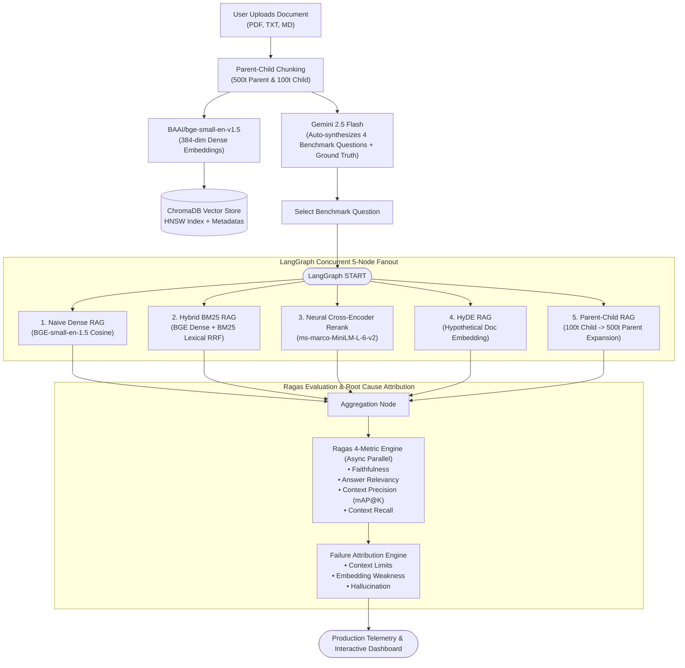

<div align="center">

# ⚡ RAGLens
### Production RAG Evaluation, Benchmarking & Failure Attribution Platform

[](https://raglens.vercel.app)
[](https://github.com/Japnitsingh123/RAGLens)
[](https://python.org)
[](https://huggingface.co/BAAI/bge-small-en-v1.5)
[](https://huggingface.co/cross-encoder/ms-marco-MiniLM-L-6-v2)
[](https://www.trychroma.com)
[](https://langchain-ai.github.io/langgraph/)
[](https://docs.ragas.io/)

<p align="center">
  <b>Upload any document, index with BGE-small-en-1.5 into ChromaDB, synthesize benchmark questions with Gemini, and evaluate 5 RAG architectures concurrently via LangGraph & Ragas 4-metric failure attribution.</b>
</p>

[**🚀 Open Live Web App**](https://raglens.vercel.app) • [**📚 Interactive API Docs**](http://localhost:8000/docs) • [**⚡ Quickstart**](#-quickstart-in-3-steps)

</div>

---

## 📌 Executive Summary

> - **Production RAG Benchmarking Platform:** Benchmarks 5 production retrieval architectures—**Naive Dense, Hybrid BM25, Neural Cross-Encoder Rerank, HyDE, and Parent-Child Expansion**—in parallel via **LangGraph**.
> - **BAAI/bge-small-en-v1.5 Embeddings:** 384-dimensional dense vectors with high retrieval precision and fast batch ingestion (`batch_size=32`) into ChromaDB.
> - **Neural Cross-Encoder Reranking:** Powered by `cross-encoder/ms-marco-MiniLM-L-6-v2` 
> - **Automated Testset Synthesis:** Generates nuanced evaluation questions and ground-truth references directly from uploaded documents using **Gemini 2.5 Flash**.
> - **Ragas 4 Canonical Metrics & Failure Attribution:** Evaluates **Faithfulness**, **Answer Relevancy**, **Context Precision**, and **Context Recall** plus **Harmonic Ragas Score**, automatically attributing failure root causes (*Context Limits, Embedding Weakness, Hallucination*).

---

## 🧭 System Architecture



---

## 🔬 The 5 Benchmarked Strategies

Click on any strategy below to view how it operates, its underlying models, and diagnostic trade-offs:

<details open>
<summary><b>1. Naive Dense RAG (Baseline)</b></summary>
<br>

- **Vector Embedding:** `BAAI/bge-small-en-v1.5` (384-dim).
- **How it works:** Encodes user query and retrieves top-3 nearest neighbors by cosine similarity in ChromaDB.
- **Trade-off:** Fast and simple baseline, but susceptible to **Context Limits** (boundary cutoffs) and **Embedding Weakness** (dense vector dilution on specific acronyms/version numbers).
</details>

<details>
<summary><b>2. Hybrid BM25 RAG (Solves Embedding Weakness)</b></summary>
<br>

- **How it works:** Combines dense ChromaDB vector search with sparse BM25 tokenized lexical matching via **Reciprocal Rank Fusion (RRF)**:
- **Best for:** Queries containing specific product codes, ciphers, and acronyms (e.g., `AES-256-GCM`, `FIPS 140-3`, `TLS 1.3`).
</details>

<details>
<summary><b>3. Neural Cross-Encoder Rerank (Deep Semantic Relevance)</b></summary>
<br>

- **Reranker Model:** `cross-encoder/ms-marco-MiniLM-L-6-v2` 
- **How it works:** Initially retrieves 9 candidate chunks from ChromaDB and calculates relevance scores using Cross Encoder.
</details>

<details>
<summary><b>4. HyDE — Hypothetical Document Embeddings (Solves Query Asymmetry)</b></summary>
<br>

- **How it works:** Generates a hypothetical reference answer using an LLM first, embeds the generated answer with `BAAI/bge-small-en-v1.5`, and searches ChromaDB for neighboring chunks in document-space rather than query-space.
- **Best for:** Exploratory, conceptual, or brief queries where the user's phrasing differs significantly from documentation terminology.
</details>

<details>
<summary><b>5. Parent-Child Chunk Expansion (Solves Context Limits)</b></summary>
<br>

- **How it works:** Indexes granular 100-token child chunks for high-precision retrieval in ChromaDB, then resolves metadata `parent_id` to expand into the full enclosing 500-token parent document before sending to the LLM generator.
- **Best for:** Architectural questions where isolated chunks truncate critical prerequisite or follow-up details.
</details>

---

## 🎯 Ragas 4-Metric LLM-as-a-Judge & Failure Attribution

RAGLens implements the 4 standard **Ragas** metrics combined with automated root-cause diagnostics:

### 1. The 4 Canonical Ragas Evaluation Metrics

- **Faithfulness:** Measures whether generated answers are factually supported by the retrieved context.
- **Answer Relevancy:** Evaluates how relevant and directly related the generated answer is to the user's query.
- **Context Precision:** Measures whether relevant retrieved chunks are ranked higher than irrelevant ones.
- **Context Recall:** Measures whether the retrieved context contains all the information required to answer the query.

### 2. Failure Attribution Engine
<details>
<summary><b>🔍 How Failure Diagnostics Work (Click to Expand)</b></summary>
<br>

When a strategy scores below threshold, RAGLens identifies the exact pipeline bottleneck:
- **`Context Limits`**: Triggered when `Context Recall < 0.65` or context truncation is detected.  
  *Recommendation:* Upgrade to Parent-Child chunk expansion or increase context chunk size.
- **`Embedding Weakness`**: Triggered when `Context Precision < 0.60` due to dense semantic dilution of specific keywords.  
  *Recommendation:* Enable Hybrid BM25 with Reciprocal Rank Fusion or neural Cross-Encoder reranking.
- **`Hallucination`**: Triggered when `Faithfulness < 0.70`.  
  *Recommendation:* Lower generation temperature to 0.0, tighten system prompt constraints, or enforce strict quotation requirements.
</details>

---

## ⚡ Quickstart in 3 Steps

### 1. Clone & Install
```bash
git clone https://github.com/Japnitsingh123/RAGLens.git
cd RAGLens
pip install -r requirements.txt
```

### 2. Configure Environment (`.env`)
```bash
# Add your Gemini API key (also includes built-in deterministic fallback)
GEMINI_API_KEY="your_api_key_here"

### 3. Launch App
```bash
python main.py
```
- 🌐 **Interactive Dashboard:** [http://localhost:8000](http://localhost:8000)
- 📖 **Interactive Swagger Docs:** [http://localhost:8000/docs](http://localhost:8000/docs)

### Run Test Suite
```bash
pytest tests/test_raglens.py
```
*(All 7 unit and integration tests verify BGE-small-en-1.5, Neural Cross-Encoder, and Ragas 4-metric evaluations).*

---

## 🛠️ Production Tech Stack

| Layer | Technology | Details |
|---|---|---|
| **Frontend** | Modern Next.js 14 Aesthetic | Tailwind CSS, Phosphor Icons, real-time benchmark telemetry |
| **Backend API** | FastAPI | Async endpoints, Pydantic v2 schemas, CORS enabled |
| **Dense Embeddings** | `BAAI/bge-small-en-v1.5` | 384-dimensional dense vectors, batch-encoded (`batch_size=32`) |
| **Vector Database** | ChromaDB | Embedded HNSW vector store with parent/child metadata tracking |
| **Neural Reranker** | `cross-encoder/ms-marco-MiniLM-L-6-v2`
| **Orchestration** | LangGraph Parallel `StateGraph` | Asynchronous 5-node concurrent pipeline execution |
| **Evaluation Engine** | Ragas 4-Metric Engine | Faithfulness, Answer Relevancy, Context Precision, Context Recall |
| **LLM Judge / Synthesizer**| Gemini 2.5 Flash | Document question generation + claim verification judge |
| **Deployment** | Vercel Serverless Function | Fast serverless endpoints via `api/index.py` |

---

<div align="center">
  <sub>Built with ❤️ by Japnit Singh &bull; Licensed under the MIT License</sub>
</div>
